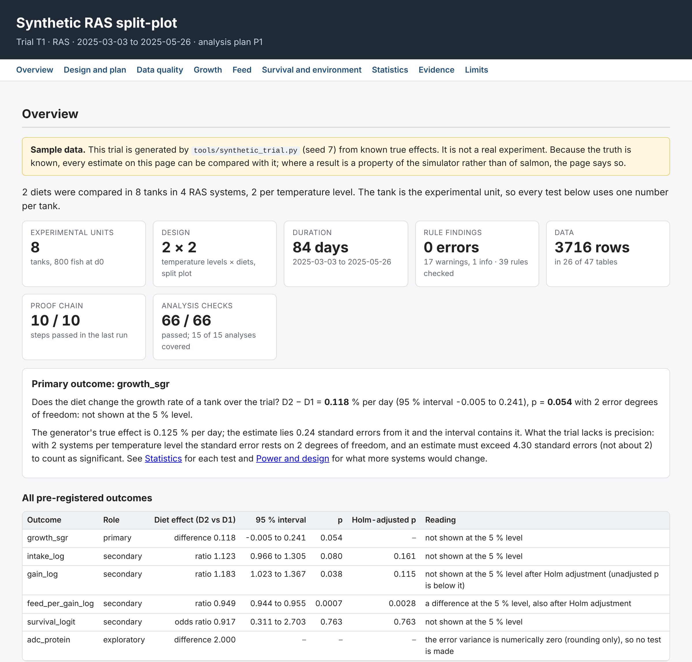

# Salmon feed trial data model

A data model for Atlantic salmon feed trials run in tanks, RAS and sea cages under
different climate conditions, built for statistical analysis. It stores the measurements and,
alongside them, what is needed to know which conclusions the data can support. It comes with
tools that build it into a database, compute the metrics, check the rules, run the planned
statistics, show the result as a dashboard and test all of it.

## Dashboard

[](https://okan-wqm.github.io/Salmon-data-model-pre-work/dashboard.html)

**[Open the full dashboard](https://okan-wqm.github.io/Salmon-data-model-pre-work/dashboard.html)**: design and plan, data quality,
growth, feed, survival and environment, every statistical test with an explanation, power, and
the evidence from the proof chain, on one page. It is [`dashboard.html`](dashboard.html) in this
repository, served by GitHub Pages, a single self-contained file that also opens offline in any
browser. It shows the synthetic sample trial (`tools/synthetic_trial.py`), not a real experiment, and was built from
the commit named on the page; after a change, run the proof chain and rebuild it with
`python3 tools/build_dashboard.py data_model.yaml --out dashboard.html`.

The model is a starting point. Column vocabularies and importers have to be fitted to an
organisation's own systems before it is used on real data (see [Adapting it](#adapting-it)).

Requirements: Python 3.12 (3.11 also runs the chain) and `pyyaml` for the schema, metrics and
rules; `numpy` and `scipy` for the statistics; `matplotlib` for the dashboard. SQLite is built
in. No R, no database server.

## Quick start

```bash
pip install pyyaml -r requirements-analysis.txt -r requirements-dashboard.txt
python3 tools/run_all_tests.py data_model.yaml        # full proof chain, about 6 min
python3 tools/validate.py data_model.yaml trial.db    # rule findings; exit code 1 on error
python3 tools/metrics.py  data_model.yaml trial.db    # one analysis row per tank or cage
python3 tools/analysis.py data_model.yaml trial.db    # the planned outcomes, test by test
python3 tools/build_dashboard.py data_model.yaml trial.db --out dashboard.html
```

Without a database file, these tools build the synthetic trial in memory. The schema, metric
and rule tools need `pyyaml` only.

## What the model settles before any statistics

| Question | Answer in the model |
|---|---|
| What is the experimental unit? | The tank or cage (`units`), never the fish. Fish-level data are nested in units. |
| At what level was each factor applied? | `design_factors.applied_at` = unit, system or site. A temperature set per RAS loop is a whole-plot factor; rule R35 requires it to be tested against systems, not tanks. |
| Was "climate" assigned or only observed? | `design_factors.role` separates an assigned treatment from an observed condition. With one site per climate level the climate effect cannot be separated from the site effect; rule R02 reports this as an error when the factor is a term of a planned model, otherwise as a warning. |
| When does a period start and end? | One half-open window per period. Feed, degree-days and count-changing events on a weighing day belong to the next period (fish are fasted before weighing); an event that happened before the weighing is marked as such. |
| How are missing days handled? | One `period_sum` rule for every period total: physically defensible inputs are filled first (temperature from the system sensor or short interpolation, uneaten feed from the unit's own ratio), the total is rescaled by coverage, and the number of observed and imputed days is always reported. Below a coverage threshold the value is NULL; a NULL is never read as zero. |
| How are fish counts kept? | Count-changing event types are defined once (`event_types`) with their direction and survival role; the running count is reconciled at every recount with a tolerance (R04). |
| Which analysis population? | ITT = all randomised units; mITT and per-protocol are defined; pending exclusions stay in; exclusions are logged with who decided them and when. Raw data are never altered: removing a record requires a logged decision (R15). |
| Which covariates are allowed? | `covariate_roles` marks post-randomisation variables (oxygen, density, lice) as mediators; adjusting for them under a total-effect estimand is an error (R28). |
| How is each metric computed? | `derived_metrics` gives one definition each, with units and windows: SGR, TGC and degree-days, gross / apparent / biological FCR, intake corrected for uneaten feed (Helland et al. 1996), digestibility with an inert marker, nutrient retention, survival, organ indices, lice per fish, density, unionised ammonia and daylength (including polar day and night). |

## What it records

- **Design.** Factors and levels, randomisation runs, blocks, factorial diets, cohorts, blinding and unblinding time, a versioned analysis plan with pre-registered outcomes (error strata, estimand, multiplicity, equivalence margin, power inputs).
- **Units and time.** Sampling occasions with a numeric order and one date each, tank or cage geometry over time, moves between systems, individually tagged fish.
- **Growth.** Weighings by type (stocking, bulk in several lots, individual, sample, harvest) with weight basis, and biomass cameras with calibration against manual samples and algorithm-version tracking. The weight of a unit comes from a count, else a calibrated camera, else a sample; mixing sources across diets is flagged (R40).
- **Feed.** Daily feed per unit and batch, batches with composition drift, placeholder batches when a feeding system knows the feed type but not the lot, feed split across cages from a barge, off-protocol feed, uneaten feed and recovery tests, pellet quality.
- **Environment.** Sensor series with a fallback chain, setpoint schedules, light regimes, water samples with detection limits, site latitude for daylength.
- **Events and health.** Mortality, culls, sampling, escapes, transfers, harvest, lice treatments, blooms and storms, with cause categories for competing risks; lice counts in the Norwegian reporting convention.
- **Composition and digestibility.** Open analyte list with units and basis (wet, dry matter, as fed), censoring, lab run and report revision, feces collection method.
- **Terminal quality and welfare.** Organ weights and yields, fillet colour and texture, ordinal scores on defined scales with rater identity, tissue samples and assay results.
- **Provenance.** Import batches with file hashes and source clocks, superseding re-exports, an audit log, analysis runs that make a reported number reproducible, ethics permits.

Tables are tiered: 28 core tables and the error-severity rules are the minimum for valid
inference; 19 optional tables can stay empty in a first trial.

## Analyses it supports

- Diet effects with linear mixed models, the tank or cage as unit and initial weight as covariate.
- Diet × temperature split-plot models with system as the whole-plot stratum.
- Growth curves as repeated measures on a common time axis, with time-varying temperature and daylength.
- Dose-response on analysed rather than nominal dose.
- Survival with binomial GLMM, Cox models with unit frailty or Kaplan–Meier; deaths and moribund culls are separated from censoring through event classes.
- Ordinal welfare and quality scores with cumulative link models.
- Multi-site and multi-trial pooling through site and climate covariates, cross-trial formulation IDs and pre-registered outcomes.

`tools/analysis.py` implements the first two for unit-level outcomes (stratum ANOVA and
contrasts, exact randomisation tests, Holm adjustment, power). The others are supported by the
schema and have no reference implementation yet.

The schema also states what not to do: SGR is not compared across temperatures, TGC is a
descriptor rather than an inferential quantity, and ratios such as FCR are modelled as feed
and gain rather than analysed as ratios.

## Tools

| Tool | What it does |
|---|---|
| `tools/build_db.py` | Builds the schema into SQLite STRICT tables: types, vocabularies, ranges, date formats, composite keys, rule constraints, and the event constraints generated from `event_types` |
| `tools/check_schema.py` | Checks the schema file itself: every column, rule, constraint and threshold named in the text exists |
| `tools/metrics.py` | Reference implementation of all 38 metric definitions, one function per key, and the one-row-per-unit analysis dataset |
| `tools/validate.py` | Rule engine for the 39 rules that need more than a database constraint; reports findings by severity and never writes to the data |
| `tools/calibrate_params.py` | Estimates six rule thresholds (initial CV and mean difference, count tolerance, negative growth, minimum recovery, temperature jump) and the power inputs (within- and between-unit CV, ICC) from historical trials; thresholds that are policy decisions are left as configured |
| `tools/analysis.py` | Runs the pre-registered outcomes of `planned_outcomes`: split-plot ANOVA with system and tank error strata, contrasts with intervals, exact randomisation tests, Holm adjustment, variance components, power and minimum detectable difference, a sensitivity analysis without pending exclusions, and the hashes of an `analysis_runs` row; never writes to the data |
| `tools/build_dashboard.py` | One self-contained HTML page (no JavaScript, no network): design, data quality, growth, feed, survival, the statistics with an explanation of every test, and the evidence from the last proof-chain run |
| `tools/synthetic_trial.py` | A RAS split-plot trial (2 temperatures × 2 diets, 8 tanks, 84 days) with known true values and its recorded analysis plan, used by the tests |
| `tools/run_all_tests.py` | Runs the proof chain below in dependency order |

All tools take `[data_model.yaml] [database]` on the command line.

## Proof chain

`tools/run_all_tests.py` runs ten steps and stops at the first failure. The same chain runs
in CI on every push and pull request. It takes about 6 minutes on Linux (step 9 about 4) and also runs on Windows, where step 9 takes longer.

1. **Schema.** Every name used in a rule, metric or threshold exists.
2. **Database.** The schema builds.
3. **Constraints.** 92 invalid rows are rejected. Each is also loaded into a database rebuilt without its own target check and must then be accepted, which proves the rejection comes from that check. Every constraint has a probe.
4. **Synthetic trial.** 3,716 rows load under all constraints, including its analysis plan.
5. **Metrics.** All 38 metrics are compared with the trial's known true values or with hand calculations (297 checks). The tests require biological FCR, intake and protein intake within 2 % of the truth, biomass gain within 0.5 % and survival exactly; the current run agrees within 0.01 %.
6. **Rules.** The clean trial produces no errors. Each of the 39 validator rules fires, alone and with its declared severity, on a change made to a copy of the trial (56 changes, including ones just outside a threshold that must fire and ones just inside that must stay silent). The four plan-dependent rules are silent on the recorded plan and report "not checked" when the plan rows are removed.
7. **Thresholds.** The calibration recovers the variation built into the data, detects an injected 3 % recount error and withholds estimates on too few observations.
8. **Analyses.** Every analysis is checked against something it did not compute (66 checks). Known truth: over 120 synthetic trials the estimates are unbiased and the 95 % intervals cover the true effects in 112 to 113 trials. Independent implementations: R `aov` with an error stratum, a REML mixed model, and lme4/lmerTest with Satterthwaite and Kenward-Roger degrees of freedom (stored in `tools/reference/`), least squares, brute-force relabelling, Monte-Carlo draws. Where REML puts the system variance at 0, lmerTest pools the two error strata and reports a smaller p than the planned stratum test; the test checks that this happens exactly where `tools/analysis.py` flags it. No effect: in 120 trials without a diet effect the tests reject at about 5 %. Known wrong method: with fish as replicates the same trials are "significant" in 48 % of cases.
9. **Boundaries.** Every numeric threshold is shifted ×10 and ×0.1 in a copy of the schema; a test must notice each shift (38 shifts over 20 parameters).
10. **Coverage.** The chain fails if any metric, validator rule, constraint or analysis is not exercised by a test.

`tools/test_dashboard.py` checks the dashboard on its own (12 checks): every number on the page
equals its unrounded value in the data embedded in the page, those data equal a fresh run of
the analysis, two builds are identical, nothing is loaded from outside the file and no
directory of the build machine appears in it.

## Adapting it

- **Source mapping.** Map the farm production system, the feeding system, biomass cameras and the lab system to the tables: site and unit codes, feed article to batch, analyte names, units and reporting basis. No importer is included; the shape of each organisation's exports decides it.
- **Clocks.** Record each source's clock in `import_batches.source_clock`; feeding systems that run on fixed CET and daylight-saving changes otherwise shift daily feed to the wrong day.
- **Thresholds.** The defaults in `validation_params_defaults` are placeholders. Load historical trials and run `tools/calibrate_params.py` to replace the six estimable ones; set the policy thresholds (coverage, minimum gain) in the plan.
- **Rules, metrics and analyses.** Extend `tools/validate.py`, `tools/metrics.py` and `tools/analysis.py` where the organisation's own rules, definitions or models differ; the coverage step forces a test for every addition.
- **Reference values.** After a change to the synthetic trial or the planned outcomes, remake `tools/reference/analysis_reference.json` and `tools/reference/lmer_reference.json` (see `tools/reference/make_reference.py`; needs R with lme4, lmerTest and pbkrtest, and statsmodels, which the tests themselves do not).

## Limitations

- The tests prove that the definitions are implemented as written and that every check works. They cannot prove that the definitions suit a given organisation's data; that comes only from real exports and calibration on historical trials.
- Rules R28, R30, R35 and R38 depend on the analysis plan being recorded (`planned_outcomes`, `covariate_roles`, `analysis_runs`); when it is not, the validator reports them as not checked rather than passing them. `tools/analysis.py` likewise runs recorded outcomes only, unless outcomes are passed to it explicitly.
- The synthetic trial has 2 systems per temperature, so every test has 2 error degrees of freedom: it shows how the analyses work, not what a well-replicated trial would conclude. Its generator has no variation between tanks in feed efficiency, digestibility or mortality; the dashboard marks the results this affects.
- `tools/analysis.py` covers one whole-plot factor (or none), one tank per diet in each system (replicate tanks are averaged) and each diet against the reference diet. Repeated-measures growth curves, time-to-event models, dose-response, ordinal models and pooling of trials are not implemented.
- The dashboard is static: it is rebuilt, not refreshed.
- Model formulas and error strata in the plan are free text and are parsed conservatively.
- The synthetic trial is a tank trial. Sea-cage features (camera weights, split feed, estimated escapes, interference) are covered by small hand-built test cases, not by an end-to-end cage trial.
- Deferred, not modelled: RAS operations log, diet ingredient matrix, maturation census, neighbour-farm exposure, ontology mapping.
